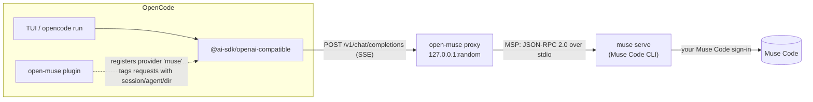

<p align="center">
  
</p>

<p align="center">
  <a href="LICENSE"></a>
  
  
  
</p>

`open-muse` connects [OpenCode](https://opencode.ai) to the models in your
[Muse Code](https://dev.meta.ai/products/muse-code) subscription. It's one OpenCode plugin:
it registers a `muse` provider, runs a small local OpenAI-compatible proxy inside OpenCode, and
drives the official Muse Code CLI (`muse serve`) through Meta's published session protocol.
Prompts, streamed replies, reasoning summaries, and Muse's tool activity flow back into OpenCode.

No API key, no pay-as-you-go billing: requests run under the `muse` CLI's own sign-in and count
against your plan.

---

- [How it works](#how-it-works)
- [Requirements](#requirements)
- [Installation](#installation)
- [Usage](#usage)
- [Models and reasoning effort](#models-and-reasoning-effort)
- [Behaviour in detail](#behaviour-in-detail)
- [Configuration](#configuration)
- [Standalone proxy](#standalone-proxy)
- [Troubleshooting](#troubleshooting)
- [FAQ](#faq)
- [Architecture](#architecture)
- [Development](#development)
- [Roadmap](#roadmap)
- [Disclaimer](#disclaimer)

## How it works



1. **The plugin loads.** It starts the proxy (one per OpenCode process), registers a `muse`
   provider pointing at it, and adds your account's models.
2. **You send a message.** OpenCode posts the conversation to the proxy. The plugin's
   `chat.headers` hook tags the request with the OpenCode session id, the agent (`build`,
   `plan`, `title`, …), and the project directory.
3. **The proxy finds or creates a Muse session** for that OpenCode session and sends only the
   new message as a Muse turn, with your selected model and reasoning effort.
4. **Muse works.** Muse Code's agent runs in your project directory with its own sandboxed
   tools. Its reply, reasoning summary, and a short trace of each tool call stream back as
   OpenAI `chat.completion.chunk` events.
5. **The turn ends.** Token usage is reported back to OpenCode, and the session mapping is saved
   so the conversation picks up where it left off, even after a restart.

## Requirements

| | |
|---|---|
| **OpenCode** | 1.x (tested with 1.18.30) or 2.x (tested with 2.0.27) |
| **Muse Code CLI** | 1.4.x (`@muse-code/sdk` is pinned to the matching release) |
| **Muse Code plan** | Any plan; signed in through the CLI |
| **OS** | macOS (Apple Silicon and Intel), Linux, Windows 10/11 |
| **Tested on** | Windows 11 x64 (OpenCode 1.18.30 and 2.0.27) and macOS 27 on Apple Silicon (OpenCode 2.0.27), both with Muse Code 1.4.6 |
| **Node.js** | ≥ 20, only for the `open-muse` CLI and building from source (inside OpenCode the plugin runs on OpenCode's own runtime) |

## Installation

### 1. Install and sign in to Muse Code

```bash
# macOS / Linux
curl -fsSL https://dev.meta.ai/install.sh | sh
```

```powershell
# Windows (PowerShell)
irm https://dev.meta.ai/install.ps1 | iex
```

Then sign in once (it opens a browser and asks you to confirm a device code):

```bash
muse login
```

**Windows only:** Muse runs its shell commands in a Windows sandbox that needs a one-time
setup with admin rights (it creates restricted local sandbox users and firewall rules). Run
this in a terminal and accept the UAC prompt:

```powershell
muse sandbox windows setup
muse sandbox windows check   # should report status=ready
```

Without it, Muse can still read and search files, but every shell command fails.

macOS and Linux need no extra step: Muse uses the built-in OS sandbox there.

### 2. Add the plugin to OpenCode

The same package works with OpenCode 1.x and 2.x, but the config key differs. Check yours
with `opencode --version`.

**OpenCode 1.x** uses `"plugin"`, in `~/.config/opencode/opencode.json`:

```json
{
  "$schema": "https://opencode.ai/config.json",
  "plugin": ["open-muse"]
}
```

**OpenCode 2.x** uses `"plugins"` (in the same file, or in `$OPENCODE_CONFIG_DIR` if you set it):

```json
{
  "plugins": [{ "package": "open-muse" }]
}
```

From source:

```bash
git clone https://github.com/jaylamping/open-muse.git
cd open-muse
npm install
npm run build
```

Then point OpenCode at the checkout. 1.x takes the built file; 2.x takes the folder (it loads
the root `server.js`):

```json
{ "plugin": ["file:///absolute/path/to/open-muse/dist/plugin.js"] }
```

```json
{ "plugins": [{ "package": "file:///absolute/path/to/open-muse" }] }
```

On macOS the path looks like `file:///Users/you/code/open-muse`; on Windows,
`file:///C:/code/open-muse`.

### 3. Verify

```bash
npx open-muse doctor     # or: node dist/cli.js doctor
opencode models muse     # OpenCode 1.x
opencode models | grep '^muse/'     # OpenCode 2.x
```

`doctor` shows which `muse` binary it found, starts `muse serve`, lists the models your
account can use with each model's default effort in standard vs contributor mode, runs one
tiny turn in an empty temp folder to confirm you're signed in (a few tokens of quota; skip
it with `--no-turn`), then shows the subscription quota (5h window and weekly percent),
and on Windows checks the sandbox. The `models` command should print entries like
`muse/muse-wonder-1.0`.

Restart OpenCode after installing or upgrading.

## Usage

Pick a `muse/*` model from OpenCode's model picker (`/models`), or:

```bash
opencode run --model muse/muse-wonder-1.0 "Summarise this repository in five bullets."
```

```bash
# More reasoning for a harder task
opencode run --model muse/muse-wonder-1.0 --variant xhigh "Find and fix the race in src/queue.ts"

# Continue the last session
opencode run -c --model muse/muse-wonder-1.0 "Now add a regression test"
```

OpenCode 2.x has no `--variant`; put the effort after `#` in the model instead. Add
`--standalone` if no OpenCode server is running:

```bash
opencode run --standalone -m 'muse/muse-wonder-1.0#xhigh' "Find and fix the race in src/queue.ts"
```

## Models and reasoning effort

The model list comes from `muse serve` (`model/list`) for your account and is cached in the
open-muse state directory. It refreshes automatically: in the background when OpenCode
starts (if the cache is older than a day), on `GET /v1/models` when the cache is stale,
and on every `open-muse doctor` run. A model that appears tomorrow is therefore picked
up without a restart or code change. Until the first refresh these defaults
are listed:

| Model | Context | Notes |
|---|---|---|
| `muse/muse-wonder-1.0` | ~1M | Muse Code's default |
| `muse/muse-wonder-full-1.0` | ~1M | |
| `muse/muse-spark-1.3` | ~1M | |
| `muse/muse-spark-1.2` | ~1M | |

What you actually get depends on your plan; whatever `model/list` returns shows up
automatically after the next refresh. Every listed model also appears as a
`-contributor` twin (same context, output, and reasoning efforts; never the
default), so a future `muse-new-1.0` is immediately usable as `muse-new-1.0-contributor`
— this mirrors Muse Code, which itself runs in contributor mode by default.
Server-listed `-contributor` entries are always kept as-is and never duplicated.
Set `contributor: false` to list the server catalog as-is instead.

Choosing a model also chooses its mode: `-contributor` models run on a host
spawned with `muse serve --contributor-mode on`, standard models on a host
spawned with `--contributor-mode off`. Switching modes mid-conversation starts
a fresh Muse session seeded with the transcript (like edited history), while a
same-mode model change reuses the session via `session/setModel`.

Each model gets OpenCode **variants** for the reasoning tiers Muse reports (typically
`minimal`, `low`, `medium`, `high`, `xhigh`, `max`). Choosing a variant sends `reasoning_effort`, which open-muse passes
to the Muse turn. Without a variant, Muse uses the model's default effort.

## Behaviour in detail

### Muse owns the tools

Muse Code is an agent, not a bare completion endpoint. When you send a message it can read
files, run commands, edit code, and search, all inside its sandbox in your project
directory. open-muse registers the models with `tool_call: false`, so OpenCode doesn't offer
its own tools. What you see in OpenCode:

- Muse's reply, streamed as message text
- Muse's reasoning summary, shown as reasoning
- one line per tool call, also shown as reasoning by default:

```
▸ bash: npm test
▸ auto-approved: bash
  ↳ bash done
▸ edit: src/queue.ts
  ↳ edit done
```

Set `toolDisplay` to `content` to put the trace in the message, or `hidden` to drop it.

### Approvals

Muse asks for approval before risky actions. OpenCode has no way to show Muse's prompts, so
open-muse answers them using the `approvals` setting:

| `approvals` | Effect |
|---|---|
| `allow` (default) | Approve each request **once**, never "always". Muse's sandbox stays on. |
| `deny` | Deny every request and tell Muse it's in read-only mode. |
| `host` | Don't answer; Muse's own policy decides (usually default-deny). |

OpenCode's **`plan`** and **`explore`** agents are always read-only: with `allow`, their
approvals are denied.

### One Muse session per OpenCode session

OpenCode resends the full conversation on every request. A Muse session already keeps its own
history, so open-muse diffs each request against what Muse has seen:

| Situation | What happens |
|---|---|
| Same conversation plus one new message | Only the new message is sent to the existing Muse session |
| Retry of the last message | It's sent again to the same session |
| Model changed mid-conversation | `session/setModel`, then the turn |
| History edited, reverted, or compacted | A **fresh** Muse session is started and given the earlier conversation as context |
| OpenCode restarted | The saved mapping is reloaded and the Muse session resumed (`session/resume`) |

The mapping lives in `sessions.json` in the [state directory](#configuration); entries expire
after 30 days.

### Requests that aren't conversation turns

- **Session titles** (`title` agent) are generated locally from your first message, so they
  don't spend a subscription prompt. Disable with `localTitles: false`.
- **Compaction and summaries** (`compaction`/`summary` agents) run as one-off, read-only Muse
  sessions that aren't remembered.

### Cancellation and errors

- Pressing Esc in OpenCode closes the request, and open-muse sends `turn/cancel` to Muse.
- **Not signed in:** HTTP 401 with "run `muse login`".
- **Plan limit reached:** HTTP 429 with Muse's message, so OpenCode treats it as retryable.
- **`muse` not installed:** HTTP 503 with install instructions.
- **`muse serve` crashed:** it's restarted on the next request, and sessions are resumed.

### Images

Image attachments are sent to Muse as image input parts.

### Project tools in Muse

When OpenCode switches from another provider to Muse, Muse starts a fresh session that
has never seen your files. With `tools: true`, open-muse hands Muse three read-only
project tools via a per-session MCP server (`read`, `grep`, `glob`), so it can catch up
by reading the conversation's project instead of answering blindly:

```json
{
  "plugin": [
    ["file:///path/to/open-muse", { "tools": true }]
  ]
}
```

Scope and limits (v1):

- scoped to the conversation's project directory; `..` escapes and symlinks outside it
  are refused, as are `.env*`, `.git/`, `node_modules/`, and key material
  (`*.pem`, `*.key`, `id_*`, `*.p12`, `*.pfx`, `*.jks`, `*.keystore`, `credentials*`)
- read-only and bounded: 50 KB file cap with truncation notice, 50 results per
  search, 30 s timeout, 10 concurrent calls max
- enable with `"tools": true` (`OPEN_MUSE_TOOLS=true`); off by default
- execution currently happens inside the proxy: OpenCode-owned execution (permissions,
  sandboxing, audit) needs a tool-execution API that neither plugin 1.x nor 2.x
  exposes, so it's tracked as a follow-up

### Quota in the sidebar

A TUI plugin shows your subscription quota in the sidebar (`Muse quota` panel:
5h and weekly percents with progress bars and local reset times, refreshed every
minute and after each turn). On OpenCode 2.x it's discovered automatically
as the `tui` sibling of the server plugin — no config, no build needed (change the
`append` target in `tui.tsx` to move it, e.g. `prompt.footer.status`). On 1.x,
register it in `tui.json`:

```json
{
  "plugin": ["file:///path/to/open-muse/tui.tsx"]
}
```

It finds the proxy through `<stateDir>/proxy.json` (written on start), so there
is no port to configure. It shows `Muse —` when the proxy is unreachable and
never breaks the TUI.

## Configuration

Options go in the plugin entry in `opencode.json`, or in environment variables. Plugin options
take precedence.

```json
{
  "plugin": [["open-muse", { "approvals": "deny", "toolDisplay": "content" }]]
}
```

On OpenCode 2.x:

```json
{
  "plugins": [{ "package": "open-muse", "options": { "approvals": "deny", "toolDisplay": "content" } }]
}
```

| Option | Env var | Default | Description |
|---|---|---|---|
| `museBin` | `OPEN_MUSE_BIN` | `muse` | Muse Code CLI to run. Looked up on PATH and in the installer's default folders. |
| `approvals` | `OPEN_MUSE_APPROVALS` | `allow` | `allow`, `deny`, or `host` ([details](#approvals)) |
| `toolDisplay` | `OPEN_MUSE_TOOL_DISPLAY` | `reasoning` | Where tool traces go: `reasoning`, `content`, or `hidden` |
| `localTitles` | `OPEN_MUSE_LOCAL_TITLES` | `true` | Answer session-title requests locally |
| `contributor` | `OPEN_MUSE_CONTRIBUTOR` | `true` | `-contributor` models run with `--contributor-mode on`, standard models with `off`; each model gains a `-contributor` twin unless the server lists one (`false`: legacy single host, no flag, server catalog as-is) |
| `forwardSystemPrompt` | `OPEN_MUSE_FORWARD_SYSTEM` | `false` | Send OpenCode's system prompt to Muse when a session starts. Off by default because it describes OpenCode's tools, which Muse doesn't have. |
| `providerId` | `OPEN_MUSE_PROVIDER_ID` | `muse` | Provider id in OpenCode (`<id>/<model>`) |
| `port` | `OPEN_MUSE_PORT` | random | Proxy port |
| `host` | `OPEN_MUSE_HOST` | `127.0.0.1` | Proxy bind address |
| `stateDir` | `OPEN_MUSE_STATE_DIR` | see below | Where the session map and model cache are kept |
| `debug` | `OPEN_MUSE_DEBUG` | `false` | Log proxy and `muse serve` activity to stderr |
| `traceFile` | `OPEN_MUSE_TRACE_FILE` | unset | Append every protocol notification from `muse serve` to this file (JSON lines) |
| `museEnv` | — | `{}` | Extra environment variables for `muse serve`, e.g. to point it at a different config dir |
| `tools` | `OPEN_MUSE_TOOLS` | `false` | Expose read-only project tools (`read`, `grep`, `glob`) to Muse as a per-session MCP server ([details](#project-tools-in-muse)) |

State directory default: `%LOCALAPPDATA%\open-muse` on Windows, `$XDG_DATA_HOME/open-muse`
(or `~/.local/share/open-muse`) elsewhere.

To customise model metadata on OpenCode 1.x, add a regular `provider.muse` block; it's merged
over what the plugin registers:

```json
{
  "provider": {
    "muse": {
      "models": {
        "muse-wonder-1.0": { "name": "Muse Wonder (work)" }
      }
    }
  }
}
```

**How the `muse` binary is found:** Meta's installers put a launcher on PATH (`muse.cmd` on
Windows, a bash script in `~/.local/bin` on macOS and Linux) that runs `muse-bin-<version>`
from the same folder. open-muse runs that binary directly, which avoids piping the stdio
protocol through PowerShell and skips the launcher's update check on every start. It's the
same file the launcher would pick, so running `muse` yourself still keeps it updated. If
`muse` isn't on OpenCode's PATH (common for macOS apps started from the Dock), open-muse also
looks in `~/.local/bin`, `/opt/homebrew/bin` and `/usr/local/bin`.

## Standalone proxy

The proxy also works without OpenCode, for any OpenAI-compatible client:

```bash
npx open-muse serve --port 4517
```

- Base URL: `http://127.0.0.1:4517/v1`, any API key
- `GET /v1/models`, `POST /v1/chat/completions` (streaming and non-streaming)
- `GET /v1/usage`: subscription quota (`window` 5h percent and reset, `weekly` percent and reset, `tier`); `data` is `null` until the host observed a turn
- Optional headers:
  - `x-open-muse-session`: conversation id (otherwise one is derived from the first message)
  - `x-open-muse-directory`: project directory Muse should work in (otherwise the proxy's cwd)
  - `x-open-muse-agent`: `plan` or `explore` for read-only, `title` for a local title

```bash
curl http://127.0.0.1:4517/v1/chat/completions \
  -H 'content-type: application/json' \
  -H 'x-open-muse-directory: /path/to/project' \
  -d '{"model":"muse-wonder-1.0","messages":[{"role":"user","content":"What does this repo do?"}]}'
```

## Troubleshooting

Run `npx open-muse doctor` first, then turn on logging:

```bash
OPEN_MUSE_DEBUG=1 opencode
```

To see exactly what Muse sent, record the raw protocol events:

```bash
OPEN_MUSE_TRACE_FILE=/tmp/muse-trace.jsonl opencode
```

| Symptom | Fix |
|---|---|
| `Could not find the Muse Code CLI` | Install Muse Code, or set `OPEN_MUSE_BIN` to the full path. OpenCode keeps the PATH it started with, so restart it (or your terminal) after installing. |
| `Muse Code is not signed in` | Run `muse login` and finish the browser sign-in. If you run OpenCode with a custom `XDG_CONFIG_HOME`, Muse looks for its credentials there too; pass the real one through `museEnv`. |
| Shell commands fail on Windows (reads and searches work) | The Muse sandbox isn't set up. Run `muse sandbox windows setup` once (admin). `doctor` reports this. |
| `Muse Code usage limit reached` | Your plan's 5-hour window is used up. Wait for it to reset or upgrade. |
| No `muse/*` models in OpenCode | Check that the plugin entry is in the `opencode.json` you're actually using, under the right key for your version (`plugin` on 1.x, `plugins` on 2.x), and restart OpenCode. On 2.x a `file://` entry must name the open-muse folder, not `dist/plugin.js`. |
| Only the built-in default models listed | The catalog refreshes in the background; run `npx open-muse doctor` once to fetch it now. |
| Muse seems to have forgotten the conversation | History was edited or compacted, so a fresh session was seeded with a transcript. That's expected. |
| A Muse update broke the protocol | Update open-muse so its `@muse-code/sdk` matches `muse --version`. |

## FAQ

**Why not call Meta's API directly with the subscription credentials?**
Meta says the subscription works "only through the Muse Code CLI" and that its credential "is
for use with Muse Code only". Pulling that credential out of the CLI to call the backend from
another client would break those terms and put your account at risk. open-muse never touches
credentials: all traffic goes through the official `muse` binary and the SDK protocol Meta
publishes for building clients.

**Can I use a pay-as-you-go Model API key instead?**
Yes, without this plugin. Meta documents a direct OpenCode provider config for
`https://api.meta.ai/v1`, where OpenCode runs its own tools. That's billed per token, not
against your subscription.

**Why doesn't Muse use OpenCode's tools?**
Muse's session protocol doesn't let a client supply plain function tools; Muse runs its own.
The protocol does accept per-session MCP servers, which is how a future version could expose
OpenCode's tools to Muse (see the [roadmap](#roadmap)).

**How does this compare to the Cursor bridges?**
It follows [open-cursor](https://github.com/Nomadcxx/opencode-cursor)'s approach: a local
OpenAI-compatible proxy over the vendor's official SDK.
[cursor-opencode-provider](https://github.com/oakimov/cursor-opencode-provider) instead
reimplements Cursor's private wire protocol so OpenCode owns the tool loop. That approach isn't
used here, for the reason in the first question.

**Does every message cost a prompt?**
Each OpenCode message is one Muse turn. Title requests are free (generated locally); compaction
costs one turn.

## Architecture

```
src/
├── plugin.ts              OpenCode entry: shared proxy, provider registration (config hook),
│                          request tagging (chat.headers hook)
├── config.ts              Options and env vars, logger
├── cli.ts                 `open-muse doctor` / `open-muse serve`
├── proxy/
│   └── server.ts          OpenAI-compatible HTTP + SSE server, agent routing, error mapping
├── muse/
│   ├── host.ts            Supervises one `muse serve` child (spawn, handshake, respawn),
│   │                      notification fan-out, binary resolution
│   ├── sessions.ts        OpenCode session → Muse session mapping, history diffing, persistence
│   ├── turn.ts            Runs one turn: turn/start → item/* events → turn/completed,
│   │                      auto-approval, cancellation
│   └── models.ts          model/list catalog, cache, OpenCode model entries and variants
└── translate/
    └── messages.ts        OpenAI messages → Muse input parts, transcript seeding, local titles
```

How Muse events are mapped:

| Muse (MSP) | OpenAI stream |
|---|---|
| `item/delta` on an `agentMessage` (`text`) | `delta.content` |
| `item/delta` on a `reasoning` item (`summary.N`) | `delta.reasoning_content` |
| `item/started` / `item/completed` on a `toolCall` | `▸ tool: args` / `↳ tool done` trace lines |
| `approval/requested` | answered with `approval/decide` by policy, plus a trace line |
| `turn/completed` (`usage`) | final chunk with `finish_reason` and `usage` |
| `session/tokenUsage` (× N calls) | one `prompt_tokens` per turn: the peak call's input (each call re-sends the context, so summing would count it N times); outputs stay summed |
| `turn/completed` (`failed`) | HTTP 401/429/502, or an SSE `error` chunk mid-stream |

`item/completed` is treated as authoritative, so text that missed a delta is still delivered.

## Development

```bash
npm install
npm test            # build, then run the test suite (needs Node ≥ 22 for test globbing)
npm run typecheck
```

The tests run the real proxy against [`test/fake-muse.mjs`](test/fake-muse.mjs), a scripted
stand-in for `muse serve` that speaks the same JSON-RPC protocol. They cover streaming,
session reuse and reseeding, model switching, reasoning effort, approvals (allow and plan-mode
deny), local titles, auth errors, cancellation, images, restarts, and a missing binary. No
Muse account is needed.

To try a local build in OpenCode without touching your real config, point `XDG_CONFIG_HOME`
at a scratch folder containing an `opencode/opencode.json` with the `file://` plugin entry.

## Roadmap

- [x] **OpenCode tools in Muse (read-only v1):** per-session MCP server
      (`session/start` `config.mcpServers`) exposing `read`/`grep`/`glob`, scoped to the
      conversation's project with sensitive files refused. Executed locally by the proxy:
      OpenCode-owned execution needs a host API for running tools that plugins don't get
      (tracked for a follow-up)
- [ ] Show Muse approval prompts in OpenCode instead of deciding them automatically
- [ ] OpenCode 2.0 entrypoint
- [ ] `open-muse install` to edit `opencode.json` for you
- [ ] Show subscription usage (`usage/read`) in OpenCode

## Disclaimer

open-muse is an independent project, not affiliated with or endorsed by Meta or the OpenCode
project. "Muse", "Muse Code", and "Meta" are trademarks of their owners. It uses only the
public Muse Code CLI and its documented session protocol; you're responsible for using it in
line with your Muse Code plan's terms.

## License

[MIT](LICENSE)
